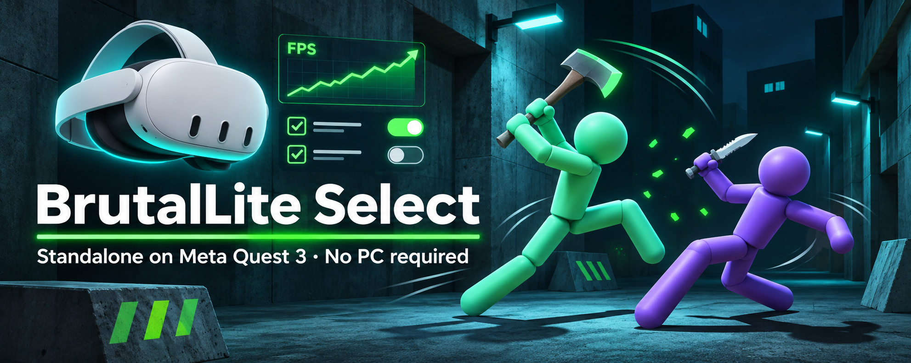

  

<h1 align="center">BrutalLite Select</h1>

<b>Play BRUTALISTICK VR standalone on Meta Quest 3 — no PC required.</b> 
A checkbox performance patch for WinlatorXR.

  
  
  
  
  
  
   
  
  
  
  
  
  
  
   
  
  
  
  
  

  <a href="#install">Install</a> ·
  <a href="#recommended-settings-quest-3">Settings</a> ·
  <a href="#what-the-checkboxes-do">Checkboxes</a> ·
  <a href="#change-settings-or-restore-the-original-game">Restore</a> ·
  <a href="#why-there-is-no-in-game-menu-melonloader">FAQ</a>

---

BrutalLite Select is a performance patch for **BRUTALISTICK VR** running **standalone on Meta Quest 3** through **WinlatorXR**, with no PC. It turns off or limits the expensive effects that make the game stutter on the headset: blood painting, bone shards, decals, particles, mesh deformation, audio reverb and post-processing. A single checkbox window lets you choose which ones.

> **You need your own legally purchased copy of BRUTALISTICK VR on Steam.**
> This repository contains **no game files**. The patch only changes a set of values inside the copy of the game you already own and installed. It does not bypass DRM, unlock content or change gameplay rules. Its only purpose is to make standalone play on Quest 3 possible.

## Status and expectations

- The game was made for PC VR. Under emulation on the Quest 3 CPU it runs, but it is not perfect. **Bugs and glitches of the original game remain.**
- Expect roughly **50–72 FPS** when a fight starts. In heavy fights it can drop to about **36 FPS**.
- At 36 FPS the headset reprojects frames, and the view looks "wobbly", as if you were wearing someone else's glasses. This comes from the game's own CPU load on one core, which this patch cannot fully remove.
- **Tip:** if the view stays wobbly after a fight, fully close and restart the game. A fresh start returns to full frame rate.
- Hats and helmets dropped by enemies, and some body pieces, can still stay on the floor. There is no safe way to give them a lifetime without code that runs during the game.

## Requirements

- Meta Quest 3.
- WinlatorXR with the VR container **Proton-11.0-2-arm64ec-WXR-VR**.
- BRUTALISTICK VR installed through WinlatorXR's Steam downloader, which installs it to `Z:\steam_games\BRUTALISTICK VR`.
- About 1.5 GB of free space for the automatic backup of the original files.
- The patch is tied to the current game build. After a game update the installer refuses to run and changes nothing.

## Recommended settings (Quest 3)

| Setting | Value |
|---|---|
| Headset refresh rate | **72 Hz** |
| PC VR render scale (shortcut settings) | **40%** |
| Screen Size (shortcut settings) | **800x600** or **1280x720**; there is almost no difference between them |
| Exec Arguments | leave empty |

Restart the headset before playing to free memory.

## Install

1. Download `BrutalLite-Select-1.0.0.zip` from [**Releases**](https://github.com/abgitdev/BrutalLite-Select/releases/latest) and copy it to the headset's **Download** folder (for example with Android File Transfer or SideQuest).
2. In WinlatorXR, open **Downloader**, go to the **MODS** tab and tap **+**.
3. Choose **Installer — a program that installs a game**, then tap **OK** on the warning.
4. Pick the ZIP, choose **An installer to run in a container**, then tap **Extract**.
5. When asked "Delete the archive?", choose **Keep It**, then **OK**. The entry `BrutalLite-Select-Setup.exe` appears in the list.
6. Open that entry's **⋮** menu, choose **Install Content**, then select the container **Proton-11.0-2-arm64ec-WXR-VR**.
7. In the BrutalLite window, tick what you want reduced and tap **Apply**. Wait for the SHA256 verification message. It can take a few minutes.
8. Start the game as usual.

## Change settings or restore the original game

Open the same list entry: **⋮ → Install Content → Proton-11.0-2-arm64ec-WXR-VR**. In the window:

- **Apply**: applies your current checkboxes. It always starts from the original backup, so switching settings is safe.
- **Restore original**: puts back the exact original game files.

Keep the `BrutalLite-Select-Setup.exe` entry in the list while the patch is installed. Removing the entry does **not** undo the patch. Your last choice is remembered.

## What the checkboxes do

Checked means that group is reduced. Unchecked means that group keeps the original game values. Where a mode is offered, **Off** is the strongest reduction.

| # | Category | Modes |
|---|---|---|
| 1 | Blood and paint (paint textures 32×32, wounds, blood particles) | — |
| 2 | Bone shards / body fracture / slicing pieces | — |
| 3 | Eyewear dropped by enemies | — |
| 4 | Mesh deformation (dents) and prop collider rebuilds | — |
| 5 | Impact decals | Off / ~5 s / ~18 s |
| 6 | Impact particles and impact queues | Off / reduced / mild |
| 7 | Empty magazines and casings | Off / ~5 s / ~18 s |
| 8 | Slide/roll impact trigger | — |
| 9 | Physics limits (physics rate, max catch-up step) | 45–60 / 50–72 / 60–90 Hz |
| 10 | Steam Audio realtime reverb | — |
| 11 | Post-processing (lens flare, bloom, chromatic aberration, lens distortion, motion blur, depth of field, vignette) | — |
| 12 | Muzzle flash particles and lights | — |
| 13 | Fracture engine budget | three levels |
| 14 | **EXPERIMENT:** AIDirector disabled. This can break enemy alarms, reactions to corpses and patrols, and can cause errors. Unchecked by default. | — |

The defaults are categories 1–13 checked, every mode on Off, and 14 unchecked.

Install log on the headset: `Download/Winlator/BrutalLite/install.log`.

## Why there is no in-game menu (MelonLoader)

A runtime mod loader such as MelonLoader or BepInEx would allow an in-game menu and a cleanup of dead enemies. It currently **crashes on Quest 3** under WinlatorXR's ARM64EC Proton with FEX. Older Wine reports the ARM64 architecture to x64 processes, so .NET/MonoMod writes ARM64 detours into x64 code. See FEX issue [#6014](https://github.com/FEX-Emu/FEX/issues/6014). The fix exists in upstream Wine (commit `c5a96a0b6c635995718602ca0d0792833de1f46f`) and in some third-party Proton builds, but it is not yet in the WinlatorXR VR container. Until then, this asset-only patch is the working option.

## Testing

- **Offline installer tests (108 checks, all passed).** The installer was run on a byte-exact copy of the supported game build. Every test applies changes, verifies them with SHA256 and restores the files. Covered cases:
  - all categories off, which must give the original bytes;
  - each category on its own;
  - all categories on;
  - every mode of each category;
  - switching between choices;
  - upgrading from earlier BrutalLite versions;
  - an interrupted install, recovered from the backup;
  - rejection of a different game build.
- **On the headset.** Tested by the author on Meta Quest 3 with WinlatorXR (Proton 11.0-2 arm64ec WXR-VR, FEX 2609): install, play and restore.

## Checksums

See `SHA256SUMS`. The ZIP contains the installer, its patch data (`BrutalLite/select.blp`), a short `INSTALL.txt`, and this project's `LICENSE`.

## Author

Made by [**abgitdev**](https://github.com/abgitdev). Issues and pull requests are welcome.

## Credits and disclaimer

- **BRUTALISTICK VR** is made by its developer (Kubunautilus). All game content and trademarks belong to them. This project is unofficial and not affiliated with or endorsed by the developer. The developer has been informed about this project.
- WinlatorXR, Winlator, Wine/Proton, FEX and DXVK belong to their respective authors.
- Provided as is, without warranty. You use it at your own risk. Always keep the installer entry so you can restore the original files.
